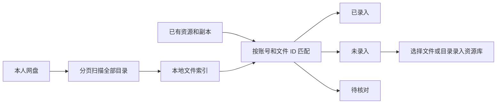

# 整盘同步与本地资源关联设计

状态：实现与验收中，使用方式见[整盘目录同步](drive-full-sync.md)。日期：2026 年 11 月 24 日。

整盘同步把本人网盘中可访问的文件和文件夹目录信息保存到本地数据库，并与已经录入的资源关联。同步后，即使账号暂时未登录，也能搜索目录、查看文件和判断哪些内容尚未录入；需要读取最新内容或修改网盘时，再使用该账号创建时确定的浏览器方式。

本轮只设计整盘同步。会员到期时间与登录问题另行处理，不作为本地目录浏览的前置条件。

## 同步范围

本地数据分为两层：完整的网盘文件索引，以及已有的资源库业务记录。一个资源可以包含整个文件夹或多个文件，不能把每个文件都直接当作一条资源。

| 数据层 | 保存内容 | 用途 |
| --- | --- | --- |
| 网盘文件索引 | 账号、文件 ID、父目录 ID、名称、路径、类型、大小、同步状态及平台实际返回的时间 | 完整目录、离线搜索、变化比对、查找未录入内容 |
| 资源库记录 | 标题、分类、简介、资源副本、分享信息及相关业务数据 | 资源管理、内容制作、后续分享与发布 |

首期扫描各平台普通个人文件区，从根目录递归读取全部分页。回收站、保险箱、团队空间等范围，只有平台适配器明确支持后才纳入；界面展示本次覆盖范围。平台未返回的大小或时间保留为空，不能用 0 或同步时间冒充远端数据。

同步只读取目录元数据，不下载文件正文，不执行转存、创建分享、插入广告或远端文件变更。已存在的资源标题、分类、简介、分享和草稿保持原有业务含义。

## 使用流程

沿用现有“网盘文件”页面和账号选择入口，增加“本地目录”和“实时网盘”两个视图。有索引时默认打开本地目录；首次使用展示说明和“同步整个网盘”主操作。登录或新增账号后可以提示同步入口，不自动启动整盘扫描。

1. 选择本人网盘账号，点击“同步整个网盘”。同步前核验账号 UID 和绑定环境，不要求用户填写页数、并发数等技术参数。
2. 同步期间展示已经发现的目录和文件，支持切页后返回查看进度，也支持暂停和继续。
3. 本地目录按“全部、已录入、未录入、待核对”筛选，可按名称搜索、浏览目录树、查看完整路径和关联资源。
4. 勾选未录入的文件或目录，点击“录入资源库”，预览将新增的资源及关联关系，再保存。
5. 后续点击“更新本地目录”，重新扫描并更新变化；旧索引在刷新期间仍可浏览。

本地视图允许选择有历史索引的未登录账号。账号停用后，历史索引仍可只读查看，远端同步和管理沿用停用限制。当前“网盘文件”仅列出已登录账号，实施时需要拆开本地浏览与远端访问的账号条件。

### 页面信息

顶部放账号选择、上次完整同步时间和同步主操作。下方显示简短状态条，主体采用目录树与文件表格，复用现有紧凑桌面样式。

| 表格信息 | 展示规则 |
| --- | --- |
| 名称与类型 | 文件夹可展开或进入，保留文件扩展名 |
| 大小 | 平台返回值；目录总大小只有完整计算后展示，部分扫描时标注统计范围 |
| 所在目录 | 支持完整路径查看与定位 |
| 录入状态 | 已录入、未录入、待核对，附关联资源数量或具体原因 |
| 本地记录时间 | 明确是最后一次读取时间，不能写成实时数据 |
| 操作 | 查看关联资源、录入资源库、打开实时目录，统一放操作列 |

同步进度先展示“已读取 120 个目录、发现 3,400 个文件、还有 28 个目录待处理”。扫描前无法知道整盘总量，不展示推算的百分比。列表使用数据库分页，目录树按展开加载，避免一次渲染全盘。

远端增删改查、上传和素材插入继续复用现有 `DriveBrowser`。从本地记录发起远端操作时，先重新读取目标并核对账号、文件 ID 和当前位置；本地缓存不能直接作为删除或替换依据。操作成功后定向刷新涉及的目录，失败则保留索引并标注错误。

## 已录入内容如何匹配

文件身份以“本地账号 ID + 已核验网盘 UID + 远端文件 ID”为准。同一指纹环境可以服务多个业务，但不同网盘账号的数据仍分别保存。

已有副本中的本人目录 ID、目标文件 ID 和所属 UID 是匹配依据。来源分享中的文件 ID、转存前的选择记录和名称相似度不能当作目标文件身份。历史副本缺少 UID 或身份尚未核验时，进入待核对，不能直接自动认领。

| 情况 | 结果 |
| --- | --- |
| 文件 ID 与同账号、同 UID 的有效副本清单一致 | 已录入，可打开对应资源 |
| 文件夹 ID 与副本的资源根目录一致 | 文件夹关联已有资源，子项逐个判断 |
| 已关联资源目录中，新增文件不在原副本清单内 | 待核对，提示“资源目录内新增文件” |
| 仅名称或路径与已有资源相同 | 不自动关联，可人工核对 |
| 同一文件被多个资源明确引用 | 展示全部关联，不合并或覆盖资源 |
| 尚未找到关联记录 | 未录入 |

资源目录被关联，不代表目录中的所有内容都已经录入。否则在目录中后来增加的文件会被错误隐藏在“已录入”里。

文件 ID 不变而发生重命名或移动时，更新索引中的名称与位置。涉及既有副本路径或清单变化时，显示核对结果并通过现有副本管理流程处理，不在扫描过程中静默改写资源业务记录。

## 从本地目录录入资源

完整目录同步完成后，所有已读取的文件信息已经在本地数据库中；“录入资源库”只负责建立资源业务记录及其关联。

默认按用户选择的目录作为一条资源，单个文件也可以独立录入。选择父目录后，不再重复为其已包含的子项创建资源；若需要细分，进入子目录后选择。大批量录入复用现有选择工具，提供数量限制、分批处理和逐项结果。

预览至少列出拟用标题、所在账号、范围、已有资源关联和重名问题。新记录默认使用文件或目录名作为标题，允许修改；重复录入同一账号和远端对象应返回已有资源，不再新建。标题相同但远端对象不同，进入现有重名核对流程，不能合并文件。

录入前重新核对选中的远端对象和目录范围；离线状态可整理选择，恢复登录后完成核对。资源保存与远端建链分开：未创建或验证分享时，资源显示“待完善分享”，不能伪装成可分享的就绪副本。后续由用户显式发起现有分享流程。

当前 `DriveFiles.share()` 的归档流程会校验分享，必要时创建分享，因此不能作为整盘同步或无分享录入的内部捷径。实施时应为“本人已有文件登记”增加独立领域入口，复用资源唯一性与副本校验规则。

## 扫描和恢复机制

现有 `DriveProvider.list()` 返回聚合后的目录数组，各适配器存在不同的分页上限。整盘同步需要增加统一的分页读取契约，返回文件、下一页游标和是否结束；继续保留现有目录浏览接口。达到保护上限、重复游标或无法确认最后一页时，必须报告该目录未完成，不能把截断结果记为整盘成功。

扫描采用持久化目录队列。每读取一页，就以短事务保存文件、发现的子目录和进度；目录队列按远端目录 ID 去重。百度的目录请求沿用路径语义，其他平台沿用各自 ID 语义，统一接口不把路径误当作所有平台的文件 ID。

首次扫描遍历全目录。后续更新仍遍历目录、按文件 ID 更新变化的记录，不承诺平台尚未提供的真正增量接口。平台具备且验证过变化游标后，再单独优化。

暂停在当前只读请求结束后停止安排下一页。继续时读取保存的队列；游标过期或进程中断后无法保证页码有效时，从未完成目录的第一页重读，按文件 ID 去重。已完成目录无需全部重来。进程重启后显示“已中断，可继续”，不自动发起网络请求。

每个账号同一时间只运行一个同步任务。同一内置会话或指纹环境中的请求串行；不同环境可复用现有批量操作的并发上限与随机错开策略。调度必须与登录核验、实时文件操作及其他共用环境业务协调，不能只在同步任务内部加锁。外部占用时等待可用环境，不关闭或接管其他业务窗口。

### 状态与失败处理

| 状态 | 用户看到的结果与恢复操作 |
| --- | --- |
| 等待环境 | 保留旧目录，环境空闲后继续 |
| 同步中 | 持续显示已读取数量，允许暂停 |
| 已暂停或已中断 | 保留已读取数据，用户点击继续 |
| 需要登录 | 停止该账号扫描，在原登录方式完成登录后继续 |
| 部分完成 | 展示失败目录数量，可只重试失败目录 |
| 已完成 | 全部队列和目录分页成功结束，记录完整同步时间 |
| 身份或环境不一致 | 停止写入，明确核对账号，不回退其他登录方式 |

临时网络错误使用有限次数的退避重试，遵守平台明确的重试时间。身份失效、人工验证和结构变化不无限重试。目录读取失败不阻止其他可读取目录完成，但任务结果必须标为部分完成。

每个任务记录账号 UID 和环境标识，执行期间沿用创建账号时固定的内置或指纹方式。换号、代理或指纹环境状态异常时暂停核对，不能把新身份的数据写进旧索引。指纹账号的请求继续在关联环境内执行。

## 文件消失与数据保留

每次扫描分配批次标识，为本次观察到的记录更新最后发现批次。刷新前不清空旧索引，分页失败、暂停和登录过期都不能导致旧数据被批量清除。

只有整个扫描范围完整成功，才把本轮未出现的旧记录标为“本轮未发现，待核对”。网盘扫描不是原子快照，扫描期间移动文件也可能造成暂时遗漏，因此不能直接断言远端已删除。用户重新定位核对后，再处理本地失效关联。

远端消失的文件不自动删除资源、分享、草稿或本地业务记录。清理本地索引是独立操作，删除本地索引不删除网盘文件。删除账号时，索引按现有账号删除规则清理，不扩展远端删除范围。

## 本地存储和代码边界

下表为拟新增的职责，实际迁移沿用实施时最新数据库版本，不预占迁移版本号。

| 存储 | 主要字段与约束 |
| --- | --- |
| `drive_index_entries` | 账号 ID、所属 UID、远端文件 ID、父目录 ID、名称、路径、类型、可空大小及远端时间、最后发现批次、本地读取时间、存在状态；账号与身份内文件 ID 唯一 |
| `drive_sync_runs` | 任务 ID、账号、UID、环境标识、范围、状态、进度、错误摘要、开始和完成时间；保留最近完整成功时间 |
| `drive_sync_folders` | 任务 ID、目录 ID、路径、页码或游标、队列状态、失败原因；同一任务目录唯一 |
| `drive_resource_entries` | 文件身份、资源副本 ID、关联依据；作为从有效副本重建的查询索引，不取代原有业务记录 |

目录查询按账号、UID 和父目录建索引；关联查询按文件身份建索引，避免每次打开目录都遍历全部资源清单。路径搜索使用本地数据库查询与分页，后续按实际规模决定是否引入全文索引。资源新增、修改、删除后同步失效或重建关联缓存，并通知所有工作台刷新。

文件索引不存 Cookie、密码或访问令牌。沿用现有凭据存储与数据备份机制；本地数据库备份应涵盖新增表。大目录按页写入，短事务之间释放执行机会，避免占住 Electron 主线程；十万级记录应通过专用数据集验证查询和写入对界面响应的影响。

后端同步服务放独立领域模块，账号认证、环境调度与平台适配复用现有能力。IPC 只暴露本地目录查询、任务状态、开始、暂停、继续、失败目录重试及本人文件登记；使用 `src/api/client.ts` 与共享类型契约。前端状态放 `src/drive-files` 专用 hooks 和组件，不扩大全量应用上下文。

## 实施顺序与验收

第一阶段完成各平台分页接口、本地索引、任务恢复、本地目录浏览及已有资源关联。六类网盘逐一验证分页结束条件，未完成适配的平台不显示可用的整盘同步入口。

第二阶段加入批量选择、录入预览和本人文件登记，打通“发现未录入内容 → 建立资源 → 完善分享”的流程。远端文件管理继续使用现有能力，避免形成第二套增删改查实现。

实施验收至少覆盖：

- 多层目录、多页、空目录、同名不同 ID、同 ID 重复出现在分页中，结果不漏页、不重复建记录。
- 十万级模拟索引分页浏览与搜索，刷新期间旧记录仍可使用，界面不整盘渲染。
- 暂停、切页、进程中断、游标失效后继续，未完成目录可恢复；重启不会自行扫描。
- 某个子目录失败或身份过期时，整体显示部分完成或需要登录，旧记录不被误标消失。
- 同名不同对象不自动合并，来源分享 ID 不误认作目标 ID，资源目录新增文件不误标已录入。
- 改名、移动、本轮未发现和再次出现时，关联记录保持可核对，不自动删除资源。
- 原生和指纹账号各沿用自身环境，共用环境串行；切换 UID 后停止旧任务写入。
- 无登录也能浏览历史索引；远端操作和正式录入前仍执行本人身份及目标核对。
- 扫描不调用下载正文、转存、建链或发布接口；资源登记不隐式建链，重复登记保持幂等。
- 在任务专属窗口按 1366×768 或 1440×900 验收目录树、长路径、进度、错误恢复及操作列。

真实平台验收先做已登录账号的只读扫描；上传、分享及远端删除等独立操作按具体授权范围另行验证。本方案不启动任何真实同步任务。
